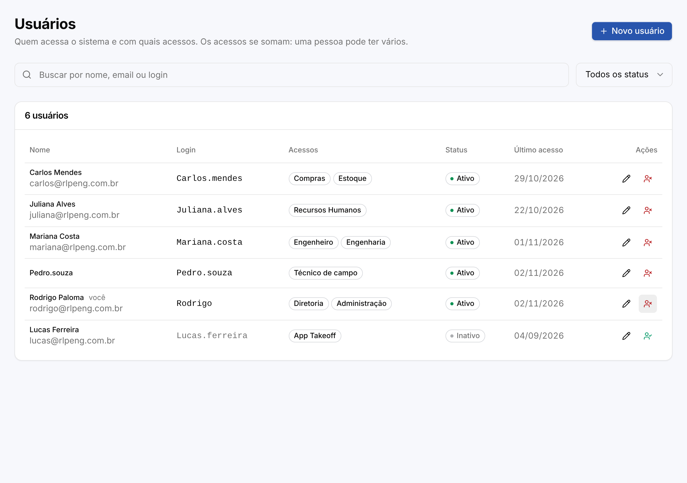
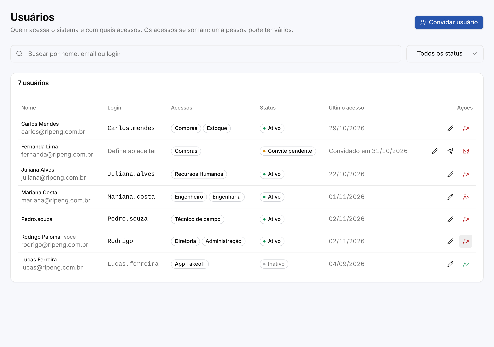
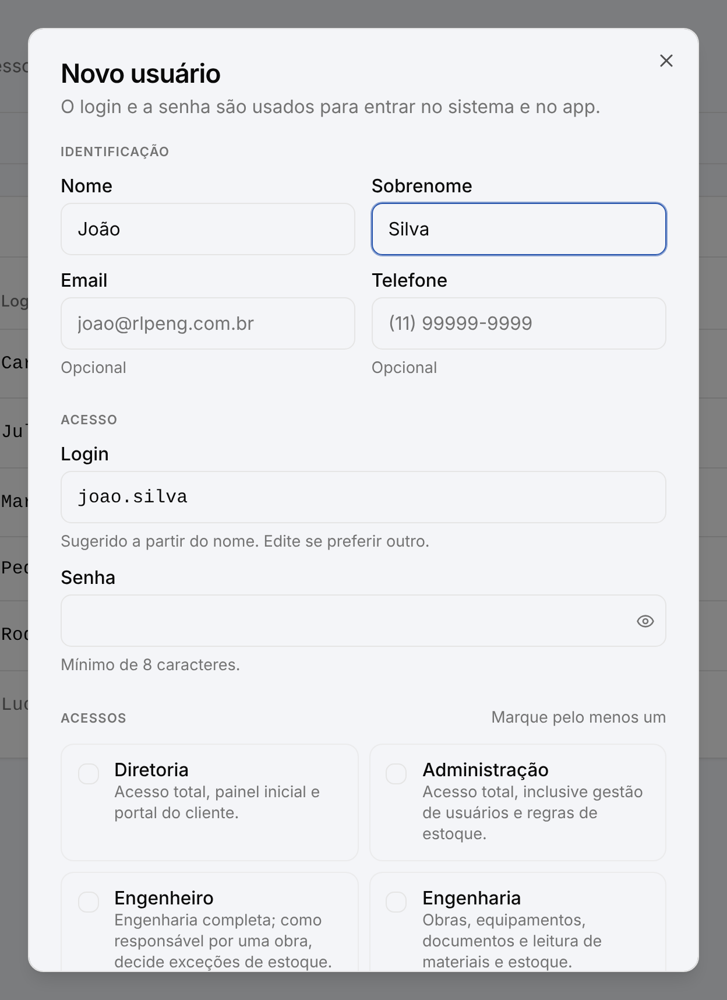
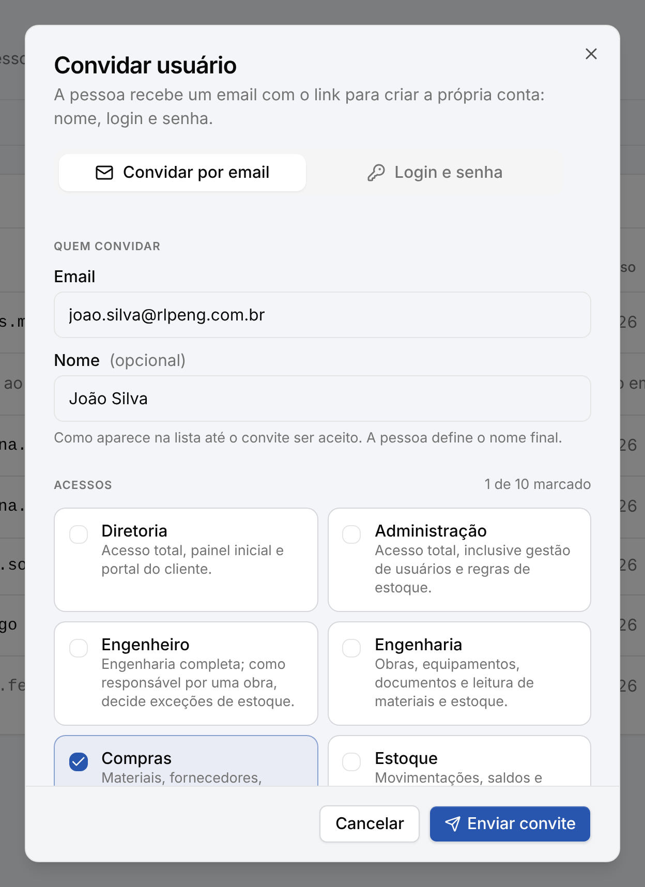
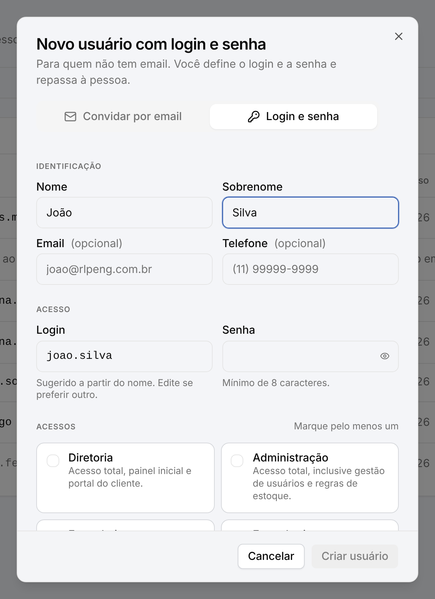
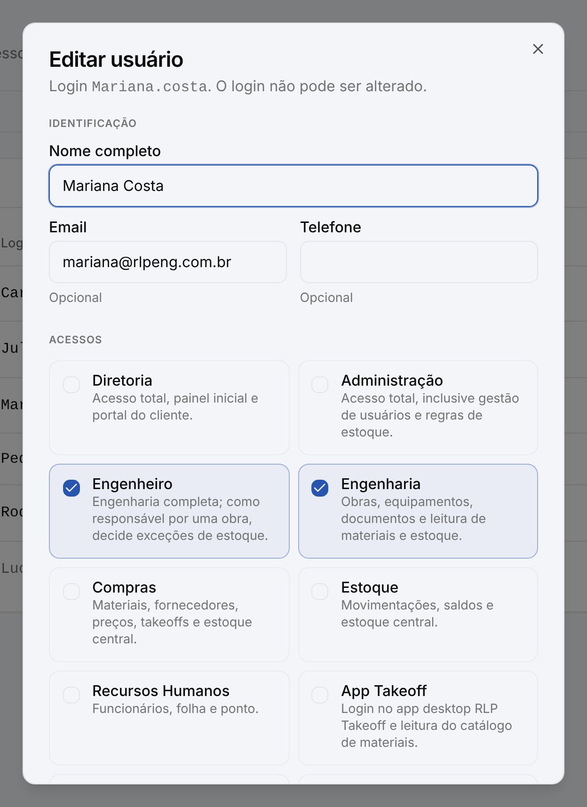
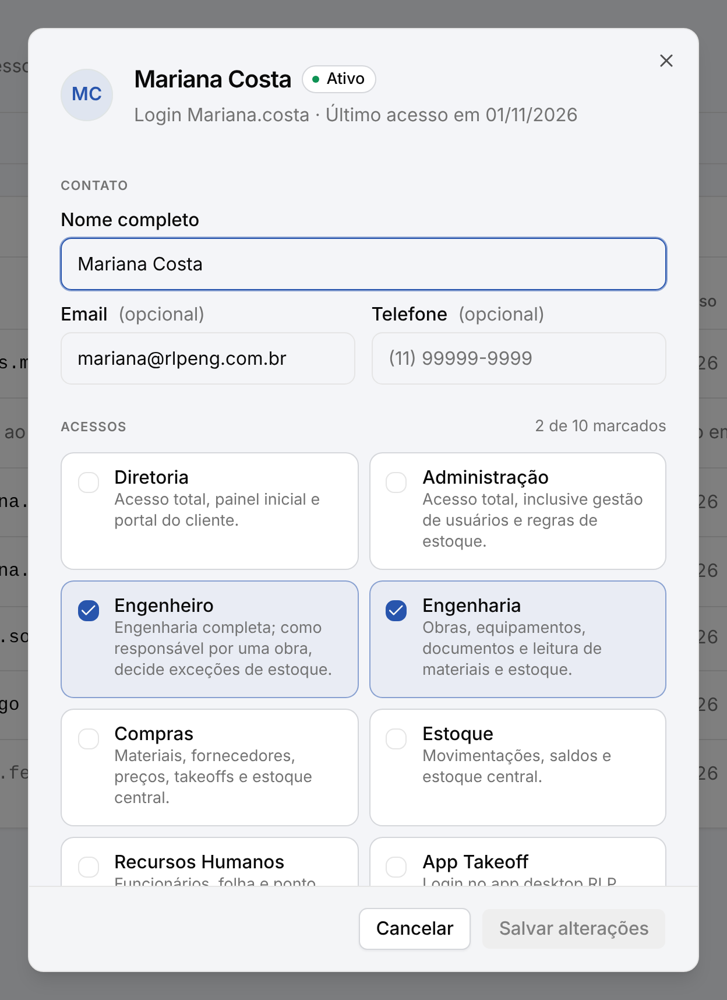
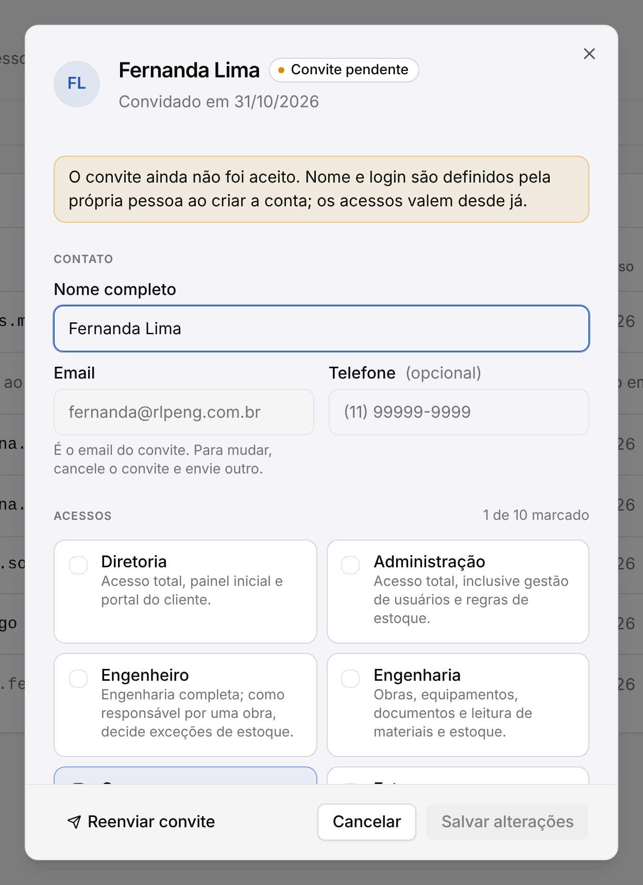
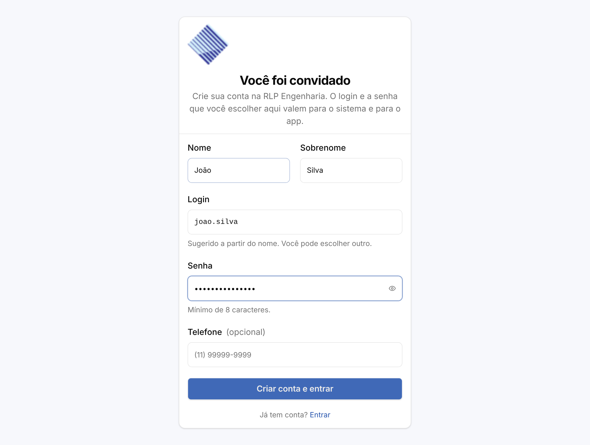

# Configurações → Usuários: antes e depois

Capturas do PR [#157](https://github.com/Patolord/rlpapp-monorepo/pull/157) (convite por email, página `/convite` e modais
revisados), feitas com dados de exemplo e Convex/Clerk mockados, em 1280 px de largura.

## Lista de usuários

| Antes | Depois |
| --- | --- |
|  |  |

Depois: botão principal "Convidar usuário", status "Convite pendente", login "Define ao aceitar",
"Convidado em" no lugar do último acesso, ações de reenviar e cancelar convite, filtro "Convites
pendentes" e o Select de status sem truncar.

## Novo usuário

| Antes (um só formulário com login e senha) | Depois: convidar por email | Depois: login e senha |
| --- | --- | --- |
|  |  |  |

## Editar usuário

| Antes | Depois | Depois: convite pendente |
| --- | --- | --- |
|  |  |  |

## Página `/convite` (nova)

